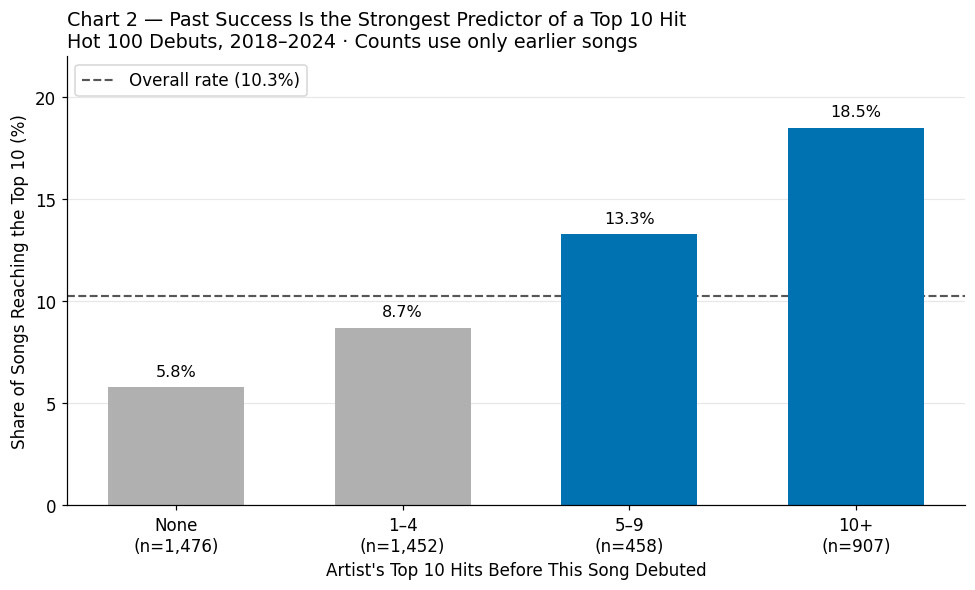
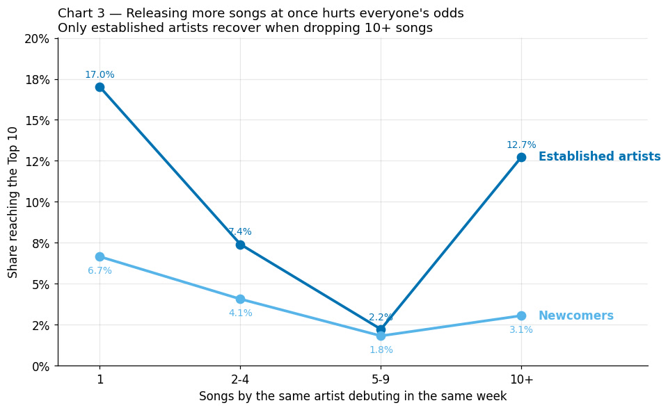
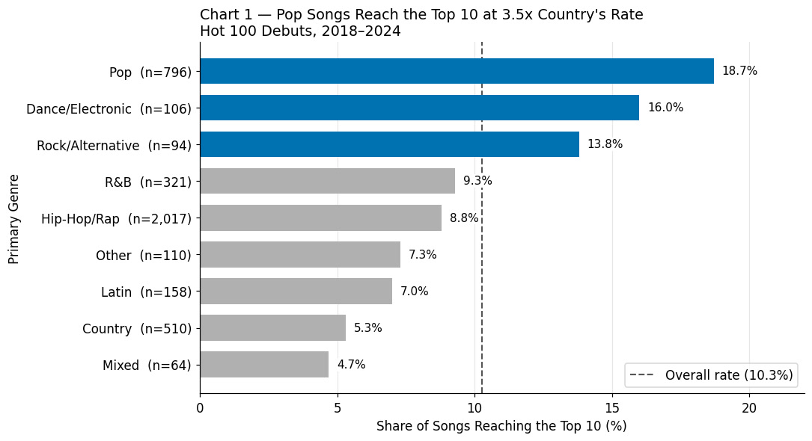

# Billboard: Top 10 or Not?

What separates a Billboard Hot 100 song that reaches the Top 10 from one that
peaks lower? We built a dataset of **5,342 songs** that entered the chart between
January 2018 and September 2026, joined the weekly chart archive to lyrics and
release metadata, tested what predicts a Top 10 hit, and built a model that flags
likely hits in their debut week. **519 songs (9.7%)** reached the Top 10. The short
answer: *who* released a song and *how* it was released matter far more than anything
measurable in its lyrics, and most hits are decided in their first week.

**Analysis:** [`A05-Billboard-Top-10-Or-Not.ipynb`](A05-Billboard-Top-10-Or-Not.ipynb).
The notebook does all of the data cleaning itself, starting from the raw files.

## Key findings

### Final phase: deeper questions

| Question | Finding |
|---|---|
| **Can we flag a hit in its debut week?** | A logistic regression trained on 2018-2024, using only debut-week facts, reaches **42.9% precision and 26.8% recall** on the unseen 2025-2026 songs, against 19.6% / 16.1% for an artist-history baseline and 5.9% for a random pick |
| **Is the album-drop penalty real?** | Holding the artist fixed, **38 of 63 artists** did better with songs released alone than with songs in a drop of 5+; only 8 did better in drops (Drake: 70.0% vs 26.5%). The singles advantage over album tracks (12.0% vs 9.2%) almost disappears among songs that debut alone (12.0% vs 11.4%) |
| **When do hits peak?** | **58.4%** of Top 10 hits peak in their debut week, and hits from 2022-2025 fade faster than hits from 2018-2021 |
| **Are songs getting shorter?** | The median chart song fell from 3:24 to 3:11 (minutes:seconds, 2018 → 2025), but Top 10 hits run longer than other songs in 7 of 8 years |
| **Do artists from outside the US convert better?** | Among artists with earlier hits, yes: 26.8% vs 15.7% for US acts at 10+ earlier hits. But Drake, Bad Bunny and The Weeknd produce 48.4% of outside-US hits, and newcomers from abroad do no better than US newcomers |

### Team Assignment (Phase 1)

Tested on the 2018-2024 training years (n = 4,293); 2025-2026 is held out.

| Finding | Top 10 rate | Test |
|---|---|---|
| **Artist history is the strongest predictor.** Past hits roughly triple the odds of the next | 5.8% (no prior Top 10s) → 18.5% (10+) | p ≈ 5×10⁻²³, V = 0.158 |
| **Album drops are U-shaped, not linear.** Filler tracks compete with each other; only superstars release 10+ at once | 11.6% alone → **2.1%** at 5-9 → 11.8% at 10+ | p ≈ 1×10⁻⁹ |
| **Genre shifts the odds, modestly.** Pop over-performs, country under-performs | pop 18.7%, country 5.3% | p ≈ 7×10⁻¹⁶, V = 0.146 |
| **No reliable hit season.** May and November look strong, partly because of superstar album weeks (e.g. Taylor Swift, 2024-05-04). Without drops of 5+ songs the month effect is no longer significant: November falls to 11.5%, May stays at 14.3% (27 of 189 songs) | May 15.1%, Nov 14.8% vs 10.3% average | p 0.009 → 0.906 |

**Null results worth reporting.** Lyric style barely separates the groups: only
vocabulary diversity differs (0.348 vs 0.361), while word count, repetition and
line length do not. Featured artists (9.6% vs 10.4%) and profanity (10.1% vs
10.5%) show no effect, and neither do collaborations (10.4% vs 10.2% for solo credits).

**Leaks we caught.** Debut position looked perfectly predictive, but a song
debuting inside the Top 10 has already met the definition of the target. A team
review (Muhammad Azaan) also found that the artist-history count included earlier
songs that became hits only after the new song debuted; the count now uses only hits
already reached at debut. The final
model therefore uses only features known in the debut week, with medians and scaling
taken from the training years only.

<p align="center">
  
  
</p>
<p align="center">
  
</p>

*Charts are saved outputs from the analysis notebook.*

## Data sources

| Source | Used for | Licence |
|---|---|---|
| [Billboard Hot 100 archive](https://github.com/mhollingshead/billboard-hot-100) (mhollingshead) | every weekly chart, 1958-2026 | **None declared** by the repository; the chart is Billboard's copyrighted compilation |
| [LRCLIB](https://lrclib.net/docs) | lyrics | **None stated** on the public docs page; lyrics belong to their rights holders |
| [MusicBrainz](https://musicbrainz.org/doc/MusicBrainz_API) | release dates, genres, artist metadata | Core data **[CC0](https://musicbrainz.org/doc/About/Data_License)** |

**Why `data/` is not in this repo.** Two of the three sources declare no licence,
and the dataset contains full song lyrics. We use them for non-commercial academic
analysis only and do not redistribute them. Fetch the data yourself (below), or get
`raw_api_data.zip` from the team Drive.

## Repository structure

| File | What it does |
|---|---|
| [`A05-Billboard-Top-10-Or-Not.ipynb`](A05-Billboard-Top-10-Or-Not.ipynb) | **The analysis (final deliverable).** Cleans the raw data step by step (one row per song, merged duplicate credits, artist history, genres, lyric features), recaps the Team Assignment, and answers five deeper questions, including a debut-week prediction model. 15 charts |
| [`scripts/01_billboard.py`](scripts/01_billboard.py) | Downloads the Billboard chart archive and lists the songs to look up |
| [`scripts/02_lyrics.py`](scripts/02_lyrics.py) | Fetches lyrics from LRCLIB, with a match-confidence score |
| [`scripts/03_musicbrainz.py`](scripts/03_musicbrainz.py) | Fetches release dates, genres (with vote counts) and artist data from MusicBrainz, at 1 request/second |
| [`archive/`](archive/) | Earlier notebook versions from the team, kept for reference. The notebook above is the submission |

Scripts 01-03 only fetch the raw data. Scripts 04-08 and their helpers
(`artist_utils.py`, `song_utils.py`) built an earlier version of the cleaned dataset.
They are kept for reference but **are no longer needed for the analysis**: the
notebook now does that work itself. [`docs/data_dictionary.md`](docs/data_dictionary.md)
describes the files those older scripts produce.

## How to reproduce

**Setup** (Python 3.14):

```bash
python3 -m venv .venv
source .venv/bin/activate
pip install -r requirements.txt
```

**Option A — fetch the data yourself (~5 hours).** Almost all of it is API time: the
MusicBrainz limit of 1 request/second dominates. Every fetch saves progress and
resumes if interrupted.

```bash
python scripts/01_billboard.py
python scripts/02_lyrics.py
python scripts/03_musicbrainz.py
```

This writes `data/raw/`. Then open the notebook.

**Option B — use the team's copy (minutes).** Download `raw_api_data.zip` (4 MB) from
the team Drive.

- **Colab:** run the notebook; the first cell asks you to upload the zip and unzips it.
- **Locally:** unzip it into `data/raw/`.

The Billboard archive is read from `data/raw/all.json` if present, otherwise downloaded
from GitHub. Either way, only charts up to 2026-09-19 are used, so results do not
change as new weeks are added. The notebook makes no API calls.

```bash
jupyter notebook A05-Billboard-Top-10-Or-Not.ipynb
```

## Team

BA780 · Team A05

- Omar Tawfik
- Caitlin Jeng
- Muhammad Azaan
- Xiaoquan Dai

## AI assistance

Claude Code wrote the data collection scripts, the cleaning and analysis code in
the notebook, and first drafts of the written interpretations; Claude (chat) helped
plan and review. The team made the judgment calls and reviewed everything. See the
AI usage disclosure in the notebook for details.
