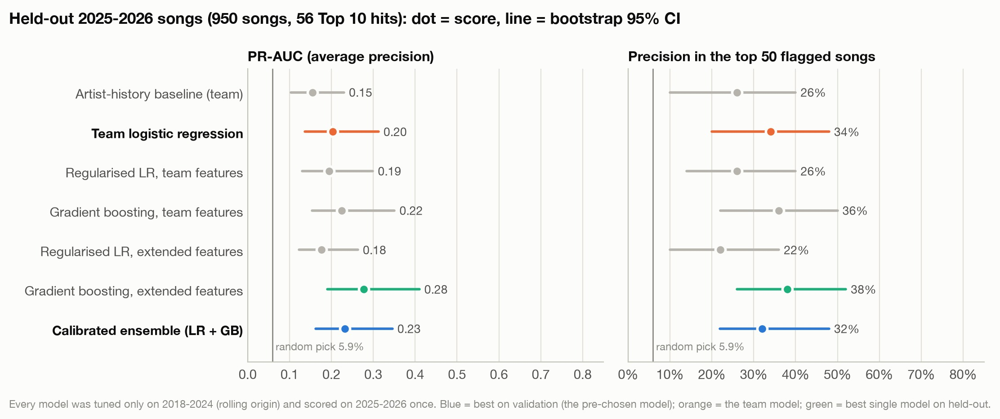
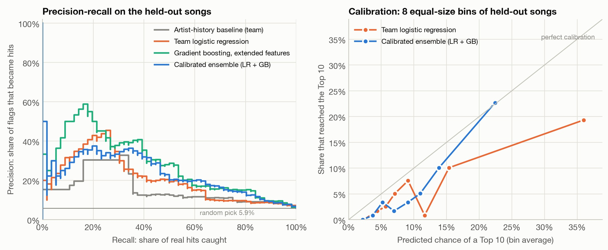
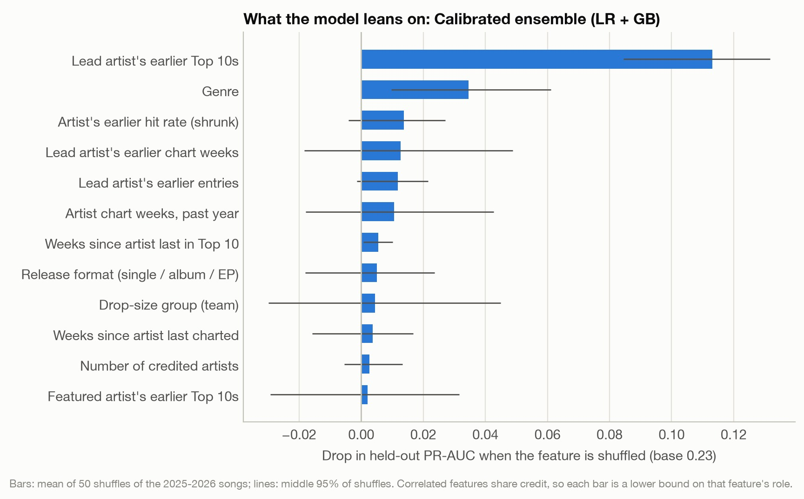
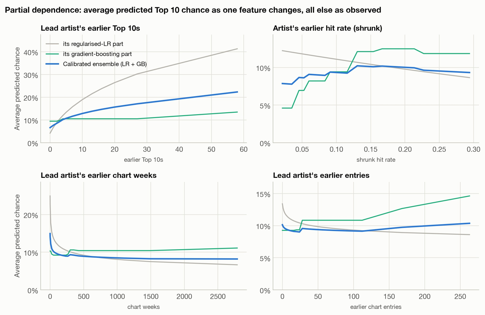

# Extension: how well can you call a Top 10 hit in its debut week, and why?

**Extension by Omar Tawfik, building on Team A05's project** (BA780: Omar Tawfik, Caitlin
Jeng, Muhammad Azaan, Xiaoquan Dai). The team built the dataset, the leak rules and a
logistic regression (see the [main README](../README.md) and the
[notebook](../A05-Billboard-Top-10-Or-Not.ipynb)). This folder is my solo follow-up. It
reuses the team's cleaning code unchanged, then asks whether better features, other models
and a stricter evaluation do better than the team's model, and what drives the predictions.

## The short answer

- **Debut-week facts can rank songs, but they can't name the hits.** The model I chose in
  advance (a calibrated average of a regularised logistic regression and gradient boosting)
  ranks the held-out 2025-2026 songs better than the team's model. ROC-AUC rises from 0.76
  to 0.81, Brier score falls from 0.056 to 0.051, and its probabilities match observed rates
  much more closely. Its precision on the songs it flags is no better. Of its top 50 songs,
  32% became hits, against 34% for the team's model. With only 56 hits in the test years,
  none of the precision differences are statistically clear.
- **Why the ceiling: 70% of hits are decided in the debut week, and the rest are invisible
  at debut.** 39 of the 56 test-year hits were already in the Top 10 in their first week.
  All 16 hits in the ensemble's top 50 came from that group (team model: 17 of 17; gradient
  boosting: 17 of 19). The other 17 hits climbed
  into the Top 10 later (Alex Warren's "Ordinary" debuted at 61, Leon Thomas's "Mutt" at
  100), and 10 of the 17 came from artists with no earlier Top 10. No debut-week feature
  in this data separates them from the hundreds of debuts that fade.
- **What the models use: the artist's track record, then genre.** Shuffling the artist's
  earlier Top 10 count costs the model about half its held-out PR-AUC (0.23 → 0.12). Genre
  comes next. Of the new artist-momentum, release-format and competition features, only
  "weeks since the artist's last Top 10" clears zero on the held-out songs, and only barely.
- **Honest footnote: gradient boosting alone did best on the test years** (PR-AUC 0.28,
  precision in the top 50 38%), and it beats the team's model on PR-AUC with a paired 95% CI
  of +0.01 to +0.15. But I didn't choose it in advance. The validation years picked the
  ensemble, so I report the gradient-boosting result as a lead for future work, not as the
  result.

## Results on the held-out songs

Every model was tuned on 2018-2024 only and then scored **once** on the 950 songs that
debuted in 2025-2026 (56 Top 10 hits, 5.9%). Brackets are bootstrap 95% CIs from resampling
the test songs 2,000 times.

| Model | Validation PR-AUC (2019-24) | Songs flagged | Precision | Recall | PR-AUC | ROC-AUC | Brier | Precision in top 50 |
|---|---|---|---|---|---|---|---|---|
| Random pick | | | 5.9% | | 0.059 | 0.500 | | 5.9% |
| Artist-history baseline (team) | 0.192 | 46 | 19.6% (9.1-32.4) | 16.1% (7.0-26.6) | 0.155 (0.104-0.230) | 0.737 (0.674-0.797) | 0.0583 | 26% (10-40) |
| **Team logistic regression** | 0.237 | 35 | **42.9%** (26.7-60.5) | 26.8% (15.5-39.1) | 0.203 (0.136-0.312) | 0.759 (0.694-0.824) | 0.0558 (0.0463-0.0663) | 34% (20-48) |
| Regularised LR, team features | 0.237 | 203 | 15.8% (11.2-20.8) | 57.1% (44.3-70.5) | 0.194 (0.130-0.299) | 0.772 (0.710-0.830) | 0.0546 | 26% (14-40) |
| Gradient boosting, team features | 0.240 | 106 | 24.5% (16.8-33.3) | 46.4% (33.8-60.0) | 0.225 (0.154-0.351) | 0.780 (0.718-0.841) | 0.0521 | 36% (22-50) |
| Regularised LR, extended features | 0.269 | 165 | 18.8% (13.1-24.9) | 55.4% (42.6-68.8) | 0.177 (0.123-0.263) | 0.776 (0.711-0.835) | 0.0545 | 22% (10-36) |
| Gradient boosting, extended features | 0.257 | 134 | 22.4% (15.9-29.8) | 53.6% (40.7-66.7) | **0.277** (0.190-0.410) | **0.819** (0.759-0.873) | **0.0506** | **38%** (26-52) |
| **Calibrated ensemble (chosen in advance)** | **0.280** | 57 | 35.1% (23.2-48.2) | **35.7%** (23.1-48.9) | 0.232 (0.162-0.346) | 0.809 (0.746-0.863) | 0.0513 (0.0415-0.0625) | 32% (22-48) |

**Paired against the team's model** (same bootstrap resamples, so the noise from which
songs happen to be in the sample cancels out):

| Model minus team LR | PR-AUC | ROC-AUC | Brier (lower is better) | Precision in top 50 |
|---|---|---|---|---|
| Calibrated ensemble | −0.02 to +0.08 (better in 90% of resamples) | −0.01 to +0.11 (96%) | −0.008 to 0.000 (98%) | −0.08 to +0.12 (43%) |
| Gradient boosting, extended | +0.01 to +0.15 (99%) | 0.00 to +0.13 (97%) | −0.009 to −0.002 (100%) | −0.04 to +0.16 (78%) |
| Regularised LR, extended | −0.08 to +0.01 (10%) | −0.04 to +0.08 (71%) | −0.005 to +0.002 (79%) | −0.22 to 0.00 (2%) |

**How to read precision and recall in the table.** The team's model predicts "hit" above a
50% chance, and on the test songs that flags 35. My models use the threshold that maximised
F1 on the 2019-2024 validation predictions. That threshold was fixed before the test years
were scored, and it flags more songs, so precision falls and recall rises. Those two columns
compare different trade-offs. PR-AUC, ROC-AUC, Brier and precision in the top 50 don't
depend on a threshold, so they are the fair comparison.

**For context, Brier score.** Always predicting the training base rate (10.3%) scores 0.0574.
The team's model (0.0558) is only slightly better than that. The ensemble and gradient
boosting (0.051) are clearly better.

**The extended logistic regression is the cautionary tale.** It had the best single-model
validation score (0.269) but the worst test PR-AUC among the tuned models (0.177). The
validation years themselves swing a lot: the team's model scores between 0.21 and 0.28 from
one year to the next. A single 56-hit test period can't settle differences of a few points.





The right panel shows the calibration gain. Among the songs the team's model rated most
likely, it predicted a 36% chance on average, and 19% of them became hits. It is
overconfident, partly because the test years have half the base rate. In the same top bin,
the ensemble predicted 22% and 23% became hits.

## Why: what drives the predictions



**Permutation importance.** I shuffled one feature at a time across the held-out songs and
measured how much PR-AUC dropped, over 50 shuffles. Genre and the drop-size group are each
shuffled as a unit. The five lyric measures are shuffled together.

- **The lead artist's earlier Top 10s** dominate: the drop is 0.113 (0.085-0.132).
- **Genre** is the only other feature whose 95% range clears zero: 0.035 (0.010-0.061).
- Weeks since the artist's last Top 10 clears zero, but barely: 0.005 (0.001-0.010).
- Everything else is within shuffle noise on 56 hits. That includes the other new features:
  recent chart activity, release format and the featured artist's record. The artist-history features are strongly correlated with each other, so they
  share the credit. That makes each bar a lower bound, not the feature's total contribution.
- One feature *hurt* on the test years: the lead artist's country. Shuffling it raised
  PR-AUC by 0.023 (0.007-0.044). The number of new entries that week did the same, within
  noise. That points to drift between 2018-2024 and 2025-2026, not a signal worth keeping.



**Partial dependence.** Each panel shows the average predicted chance as one feature changes,
with all others as observed.

- The predicted chance rises steadily with the artist's earlier Top 10s, from about 7% at
  zero to about 22% at 58.
- The other three history features are almost flat once earlier Top 10s are known. The
  linear part even turns slightly negative on chart weeks and entries, because a long record
  *without* matching hits signals a prolific but non-hit act.
- The two components disagree in shape. Gradient boosting uses steps, the regression smooth
  curves. Averaging them is part of why the ensemble is better calibrated than either one.

## Worked examples, from the 2025-2026 predictions (calibrated ensemble)

- **Correct calls are superstar debuts.** Drake's "What Did I Miss?" ranked #2 of 950 (37%
  chance). It was released as a single, by an artist with 79 earlier Top 10s, whose last
  Top 10 was five weeks earlier. It debuted at #2. Taylor Swift's *The Life of a Showgirl*
  title track (with Sabrina Carpenter) ranked #10. It was one of 12 songs she debuted that
  week, pop, with 58 earlier Top 10s, and it peaked at #8. Three more tracks from the album,
  ranked 20th to 25th, also reached the Top 10, while "Honey", ranked 7th, peaked at 12.
- **False alarms are the same superstars' other tracks.** Drake debuted 40 songs in one week.
  The model gives every one of them the same artist, drop size and genre, so it can't tell
  "Whisper My Name" (peaked #3) from "Make Them Remember" (#19), "B's On The Table" (#12)
  or "Goose And The Juice" (#88). Its #1-ranked song, "Dog House" (Drake, Julia Wolf & Yeat),
  peaked at 53. Knowing *which* album tracks will land needs information that comes after
  release, such as streams, playlist placement or radio adds.
- **Misses are newcomers who climbed.** sombr's "Back To Friends" debuted at 90 as his first
  chart entry and peaked at 7 (ranked 522nd). Ravyn Lenae's "Love Me Not" was also a first
  entry: it debuted at 81 and peaked at 5. Leon Thomas's "Mutt" debuted at #100 and peaked at
  6. Alex Warren's "Ordinary" reached #1 from a debut at 61, with one earlier entry
  (ranked 473rd). Kehlani's "Folded" ranked 823rd: she had 16 earlier entries, none of
  them a Top 10. It debuted at 76 and peaked at 6.

The pattern is the main finding. Debut-week facts sort songs by **who released them**. That
finds most hits that arrive at the top in week one, and it is blind to hits that build.

## Method

**1. Reproduce the team's data and model first.** [`build_dataset.py`](build_dataset.py) is
the notebook's Section 3 cleaning code (Steps 1-12), lifted out cell by cell: the same
34-song credit merge, artist splitting, "hit before debut" history rule, genre rules and lyric
measures. It reproduces **5,342 songs, 519 Top 10 (9.7%)**, and the team's model exactly:
**42.9% precision / 26.8% recall** (15 of 35 flags), with the baseline at 19.6% / 16.1% and
5.9% random. `model.py` re-checks these with assertions before doing anything else.

**2. Debut-week features only.** These are the team's 13 features plus 12 new ones (defined
in [`features.py`](features.py)). The leak rules carry over:

- Debut position is never a feature: debuting at 1-10 *is* the target.
- Artist history uses only chart weeks strictly before the debut week, from the full
  1958-2026 archive.
- Imputation and scaling are fitted on each training window only.

| New feature | Definition |
|---|---|
| `prior_chart_weeks` | Lead artist's total Hot 100 chart weeks before the debut week |
| `artist_weeks_last_52` | Lead artist's chart weeks in the 52 weeks before debut (momentum) |
| `artist_songs_prev_week` | Lead artist's songs on the chart the week before debut |
| `prior_best_peak` | Lead artist's best position before debut (101 = never charted) |
| `weeks_since_last_chart` | Weeks since the lead artist last charted (capped at 520) |
| `weeks_since_last_top10` | Weeks since the lead artist last had a Top 10 song (capped at 520) |
| `prior_top10_rate` | Earlier hits ÷ earlier entries, shrunk toward 10% (+1 hit in +10 entries) |
| `feat_prior_top10s` | Most earlier Top 10s held by any non-lead credited artist (same "hit before debut" rule) |
| `same_artist_debuts` | Raw count of songs the lead artist debuted that week (the team uses 4 bins) |
| `week_new_entries` | All songs debuting that week (competition) |
| `release_format` | MusicBrainz first-release type: single / album / EP / other / unknown |
| `lead_country` | Lead artist's country: US / non-US / unknown |

**3. Models.**

- The team's two logistic regressions, reproduced exactly.
- An L1/L2-regularised logistic regression (log-transformed counts, one-hot categories).
- `HistGradientBoostingClassifier` (native missing values and categories).

The last two were each trained on the team features and on the extended set. Finally, an
ensemble averages the extended regression and the extended gradient boosting, then maps the
average through a Platt calibration fitted on the 2019-2024 out-of-time predictions.

**4. Validation.** Rolling origin inside 2018-2024: for each year *y* from 2019 to 2024,
train on 2018 to *y*−1 and validate on *y*. Hyperparameters were picked by mean validation
PR-AUC:

- Regression: penalty and C, 14 settings.
- Gradient boosting: learning rate, leaves, minimum leaf size, L2 and iterations, 72 settings.

The model to report was fixed as the one with the best validation score (the ensemble,
0.280) before the test years were scored. Every model was then refit on all of 2018-2024
and scored once on 2025-2026.

**5. Explanation.** Permutation importance on the held-out songs (50 shuffles, PR-AUC drop),
partial dependence over the pooled 2018-2026 feature distribution, and the worked examples
above (`examples.py`).

## Limitations

- **Small test set.** 56 hits in one two-year window. The CIs are wide, and one test period
  can favour a model by luck. That is why I chose the model on validation, not test.
- **The base rate shifts.** 5.9% of test songs became hits, against 10.3% in training. Part
  of that is censoring: the team excluded 99 songs still charting on 2026-09-19, and 22 of
  them were already hits. Thresholds tuned on 2018-2024 therefore flag too many test songs.
- **Same-week counts come from the debut chart itself.** These are the drop size (the team's
  convention, kept) and the number of new entries. A label knows its tracklist in advance,
  but not how many tracks will chart.
- **MusicBrainz data was fetched in 2026.** Genres and release types are crowd-sourced, and
  better-known songs get tagged more. "No genre" is a strong negative in the regression
  (−1.39), and it is partly an obscurity signal recorded after the fact. The team's model
  shares this.
- **Rolling-origin training labels.** A song that debuted late in year *y*−1 may have peaked
  in year *y*. This affects labels during tuning only, never features.
- **Correlated features.** Permutation importance splits credit among correlated artist
  features, and partial dependence for one of them partly extrapolates over the others.

## Run it

Get the raw data as in the [main README](../README.md#how-to-reproduce), unzipping
`raw_api_data.zip` into `data/raw/`. Add `all.json`, or let the script download it.
`data/` is git-ignored and must stay that way. Then run:

```bash
pip install -r extension/requirements.txt   # Python 3.14
python extension/build_dataset.py   # reproduction check, ~20 s
python extension/model.py           # tuning + one held-out evaluation, ~4 min
python extension/charts.py          # the four charts
python extension/examples.py "Calibrated ensemble"   # worked examples (local only)
```

`results/` holds aggregate outputs only (metrics, tuning log, importance, coefficients).
Song-level predictions go to `output/`, which is git-ignored like `data/`. No lyrics appear
in any output or chart.

## AI assistance

Claude Code (Anthropic) wrote the extension scripts and drafted this README at Omar
Tawfik's direction, in the same way it helped with the team project (see the main README).
